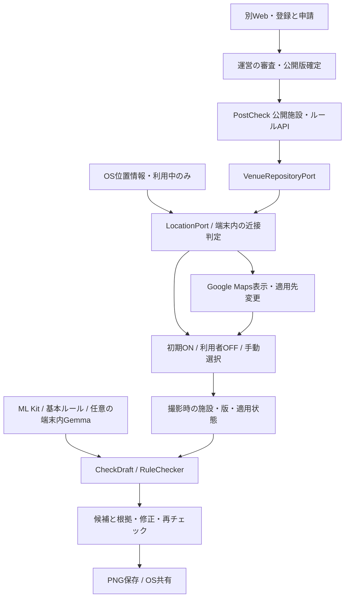

# PostCheck — 現在地に応じた公開施設ルールの構成

> **2026-11-10 ユーザー承認：一般利用はアカウント不要を基本方針とする。** 一般利用者のログイン情報を収集せず、Google／Appleログインと個人設定のクラウド保存・復元は追加予定に含めない。施設管理Webの認証・認可は維持する。詳細は[要件定義](requirements.md#73-一般利用者のアカウントとログイン情報)を参照。

更新日：2026-11-10。要件定義v0.5に対応。**端末GPS＋自前の登録施設＋Google Maps表示**で実現し、Places APIは使わない。一般利用者のGoogle／Appleログイン・クラウド復元は2026-11-10の方針で追加予定から除外。組織限定配信は後続フェーズ。自動候補・ON/OFF・撮影時スナップショットを実装。[実装記録V6](implementation-v6.md)にテスト範囲を記載。Maps実表示は利用者から確認済み。約1m移動を目安に更新する測位購読と地図追従を追加。実GPSの移動・精度・電池負荷の現場検証は未了。

## 基本構成

基本の顔・文字・連絡先・個人登録ワードのチェックは常に利用できる。その上に、近くの施設の公開ルールを自動取得して初期適用する。利用者は施設に入っていなければOFF、合っていればONのまま使う。誤推定時は施設を変更できる。

| 担当 | 役割 | 今回の扱い |
| --- | --- | --- |
| OS位置情報 / LocationPort | 前景で現在地・精度・取得時刻を取得 | 許可制。1m移動目安の購読と15秒周期の補助取得。拒否でも基本チェック可。常時追跡なし |
| 自前施設一覧 / VenueRepositoryPort | 登録施設ID・座標・公開ルールを匿名取得 | Go公開API。一覧取得後の距離計算は端末内 |
| 近接判定ユースケース | 距離・鮮度・精度・抑制状態から候補を選ぶ | 実装・単体テストあり。施設内・階・部屋を断定しない |
| Google Maps SDK | 現在地付近と登録施設ピンの表示、適用先の変更 | iOSキー設定・実表示確認済み。施設ルールの取得元ではない |
| 適用状態管理 | 自動ON、利用者OFF、手動選択、自動復帰 | OFFと手動指定を自動更新より優先 |
| CheckDraft / RuleChecker | 基本チェックと有効な施設ルールを照合 | 写真・文章・OCRは端末内。既存処理を拡張 |
| Flutter Web管理 | 施設・ルールを登録、申請、審査、公開停止 | 既存コードあり。今回の検証はローカルデモ |
| Go公開・審査ロジック / Store | 承認済み版を配信、更新競合・公開範囲を制御 | 公開読取は匿名、管理更新は認証・認可が必要 |
| Firebase Auth / 組織配信 / 復元 | 管理Webの認証・認可。一般利用者の認証・復元は旧設計 | 管理Webの認証を維持。一般アプリの認証・復元コードは未接続のまま保持し、追加予定に含めない。組織限定配信は後続 |
| Places API | Googleの施設候補検索 | 今回採用しない。キーや呼び出し経路を追加しない |

端末内の自動候補・適用状態・撮影時スナップショットまで接続済み。クラウドは未配置、通常ビルドは架空施設を明示したデモ。APIとMapsは別々に接続設定する。

## 取得・適用の流れ

**2026-11-10の変更**：利用者が自動選択・適用の半径を100mから500mへ変更するよう指定。最初の有効な測位と一覧がそろった時点で即時選択し、GPSが先に届いた場合も一覧取得後に再判定する。別施設への切替は最寄りを独立した測位で2回確認する。従来の25m以上の距離差条件を撤去。500m圏外では、離脱猶予で候補表示が残っていてもルールを自動適用しない。手動選択・明示OFF・撮影時スナップショットを優先する。[実装・今回の検証範囲](camera-nearest-rules-20261110.md)。

1. 初回に位置利用を説明し、許可済みなら利用中に約1m移動を目安とする測位購読を開始。更新が止まった際は15秒周期で補助取得する。地図は現在地ピン・精度円を更新し、手動操作で追従停止、現在地ボタンで再開。許可・測位・API応答を待たずに基本チェックを使える。
2. 小規模MVPでは `GET /v1/venues` で公開施設と有効なルールをまとめて取得。緯度経度はAPIへ送らず、端末で距離を計算する。施設ごとの分割取得は必須にしない。
3. 精度と鮮度を満たす位置から500m以内の最寄り登録施設を初期候補にする。最初の測位と一覧がそろえば即時選択する。表示は「近くの施設：〇〇（推定）」。隣接施設なら「変更」から直せる。
4. 有効なルールを取得したら撮影前の初期状態をON。「施設ルール ON／基本チェック中」と表示。取得中・不在・失敗はONと表示しない。
5. 利用者がOFFにした施設はセッション内で抑制し、位置更新や圏外再進入で再ONにしない。明示ONまたは「自動に戻す」で解除。手動施設を選んだ場合は自動で他施設へ上書きしない。
6. 自動モードで圏外に安定して出たら、その施設の適用を外して基本チェックへ戻る。候補の揺れを抑える条件・半径は[要件定義第12章](requirements.md#12-数値の仮置きと未確定事項)の検証案であり、入館判定の保証値ではない。
7. 撮影後は写真の下書きへ施設・版・適用状態を対応づける。移動で別の施設を検出してもその写真の版を上書きしない。利用者の明示変更や失効で旧チェックを無効化する。

写真ライブラリでは撮影地・日時を確認してから施設ルールを明示適用する。現在地を過去写真へ自動適用しない。文章だけの利用も現在地との関係を決めつけない。解禁判定は公開を確認する時点で行う。

## 例外・優先順位

- 施設なし／公開条件なし／OFF／GPS拒否でも、基本の顔・文字・連絡先・登録ワード検出を続ける。未確認を「撮影可」「公開OK」と表示しない。
- 複数候補、位置の低精度・古さ、取得失敗は状態を明示し、一覧・QR・手動変更・再試行で続行できる。QRから外部URLを自動巡回しない。
- 施設ON/OFFは追加の場所ルールだけを操作する。端末内企業プリセットの必須非表示や基本チェックをまとめて無効にしない。
- 適用中の撮影不可は撮影前に案内。プレビュー中の取得時も撮影不可を案内し、原文・変更・OFFへ進める。詳細はFR-LOC節を正とする。
- 公開停止・期限切れを取得したら適用解除。オフラインで同一セッションの版を参照する場合は取得時刻と最新未確認を表示。永続キャッシュ・即時プッシュは今回必須にしない。
- 遅れて到着した旧施設の応答を適用しない。前景復帰時は位置と公開版を再評価し、位置履歴は保存しない。

## データとクリーンアーキテクチャ

`domain / application` はMaps・位置情報プラグイン・HTTP・Firebaseの具体型を参照しない。

- LocationPort：独自の座標・精度・時刻を返す。OS権限・測位購読の開始／停止はアダプターに置く。
- VenueRepositoryPort：公開施設とルール版を取得。現在の共有Dart契約を使い、配信方法の変更を内部へ波及させない。
- 近接判定：候補・近接半径・精度・鮮度・連続検出・離脱猶予を評価する純粋な処理。時刻を注入し、位置情報なしでも単体テストできるようにする。
- 適用状態：auto / manual、候補ID、適用版、ON/OFF、明示OFFの施設集合、取得状態・時刻を持つ。写真のチェック対象には撮影時スナップショットを持たせる。
- RuleChecker：基本ルールと追加の施設ルールを区別し、候補へ施設ID・版・出典を付ける。施設を外す際も基本候補を失わない。
- Go：公開・審査ユースケースはStoreポートを使う。ローカルデモ用ファイルとFirestoreアダプターを分離する。一般利用者のアカウント不要方針は管理者の認可の削除を意味しない。

現在のVenuePolicyは施設座標・各種条件・ワード・解禁日時・有効期限・出典・公開範囲を持つ。LocationFix、適用状態、撮影時スナップショットを追加済み。自動適用半径500mは2026-11-10の利用者指定。候補表示の解除は離脱550m（自動適用半径＋50m）・30秒とする。Place IDやPlaceResolverPortは今回必要としない。

## 通信・認証・鍵の境界

| 経路 | データと方針 |
| --- | --- |
| Google Maps | 地図表示領域等をGoogleへ送る。現在地付近を表示すればその周辺領域が伝わる。外部通信ゼロとは説明しない |
| 自前の公開API | 施設一覧・公開版を匿名取得。初回の小規模配信では位置を要求に含めない。通信メタデータは発生し得る |
| 写真解析 | 写真・フレーム・投稿文・OCR・個人辞書を送らない。クラウド推論フォールバックなし |
| Webの申請 | 今回は架空データのローカルデモ。本番では管理者認証後に送信。公開確認した本文以外は匿名APIに出さない |
| 組織限定配信・復元 | 組織限定配信は後続で匿名配信へ含めない。個人設定の復元は追加予定なし。既存のサーバー側AES-GCM／KMS方式は旧設計として保持し、E2Eとは説明しない |

今回地図を有効にするには、iPhone用Maps SDKキー、Web管理画面で地図も使う場合はMaps JavaScript API用キーを設定する。Androidは対応を検証する段階で別設定。GPS自体や端末内ML Kit・GemmaにMaps／GeminiのAPIキーは不要。Mapsキーは用途・アプリ識別子で制限し、サーバー秘密鍵とは分ける。iOS用Mapsキー設定・実表示は確認済み。Web用キーとクラウド配置は未実施。[キー取得・設定手順](maps-api-setup.md)を参照。

一般利用者のGoogle／Appleログインは接続せず、ログイン情報を収集しない。設定は端末内に保持し、クラウド復元は追加予定に含めない。管理者の本番認証・認可も未設定の間は、登録・承認APIを匿名で公開しない。既存のローカルデモはループバック専用であり、本番の認証代替ではない。

## 実装・検証の順序

1. 完了：端末内で自動候補・適用状態・手動OFFの保持を実装し、架空位置と施設でテスト。
2. 完了：ホーム・カメラのON/OFF・変更・取得状態、撮影時スナップショットへ接続。
3. 実機でGPS拒否、隣接施設、圏外再進入、通信断、過去写真、移動後の再チェックを検証。
4. Mapsキー設定後に地図の実表示を検証。クラウド配信は別途配置するまでローカル・架空データと区別。
5. 管理者の認証・認可を維持し、組織限定配信は後続として検討する。一般利用者のGoogle／Apple認証・クラウド復元は接続・検証予定から外す。

受け入れ条件は[要件定義v0.5](requirements.md)のFR-LOC-01〜12とAC-17〜24。Cloud Runが実際に配置・利用されるまでは大会の実行基盤条件を達成したと扱わない。

旧[アーキ図V4](../output/postcheck-architecture-v4/postcheck-architecture-v4.png)と[V5 UI画像](../output/postcheck-ui-rules-admin-v5/index.html)は手動施設選択を主にした過去案。本書のMermaidと要件定義を現在の方針として優先する。

## 2026-11-08：1m移動目安への更新

利用者の指定により、前景のOS位置ストリームの距離フィルタと地図追従の移動閾値を5mから1mへ変更。日本語・英語の表示も更新した。位置の鮮度・精度判定、施設候補の連続確認、施設切替の距離差、圏外30秒の猶予、手動OFF、バックグラウンド停止は維持する。1mごとの取得や1mの測位精度、展示室の識別は保証しない。

検証：`flutter analyze --no-pub`で問題なし。位置購読・施設ルール・地図追従・関連UI・言語表示のテスト27件通過。実GPSでの細かな移動、屋内の誤差、電池負荷は未検証。

iOSリリースビルド成功。接続中のiPhone 17 Proへ更新版をインストール済み。インストール成功はGPS実測の検証結果を意味しない。

## 施設の管理権限 V17

GoogleログインでUIDを確認し、公開申請には別途公式窓口からの委任確認、または責任者からの施設単位の招待を必須にする。本人の氏名・電話・メールを施設データに集めない。運営は内容審査と初回の公式窓口確認を担当する。権限ロジックはGoのrules層、認証・暗号化はGoogleアダプター、Webは画面層に分離。[仕様・API・保存範囲](facility-access-v17.md)。
