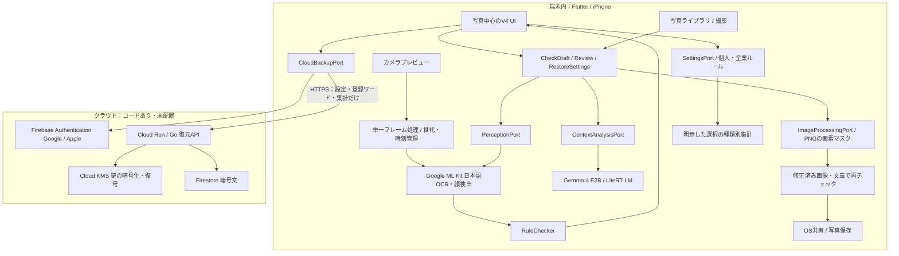

# PostCheck — 画像版の技術構成

> **最新方針（要件v0.4）**：現在地＋自前登録施設の端末内照合へ変更。Google Mapsは表示、Places APIは不使用。一般利用者の認証・組織限定配信・復元は後続。[最新の構成](architecture-rules-location.md)を優先。自動近接適用を追加済み。[実装記録V6](implementation-v6.md)を参照。以下は基礎実装の記録。

> **V5実装更新**：施設ルールの取得・端末内適用、Flutter Web管理、Goの申請・審査・公開処理を追加。[現行構成と検証](implementation-v5.md)を参照。以下は画像解析・復元の基礎構成です。

> **2026-11-08 方針追加：** 組織文書のルール化と、Googleマップ上での施設選択・QRに応じたルール取得を加えた[次期アーキテクチャ](architecture-rules-location.md)を作成しました。[最新の全体図V4](../output/postcheck-architecture-v4/postcheck-architecture-v4.png)も参照してください。以下は現行実装の構成です。追加設計と実装済みの範囲を区別し、クラウド配置延期は継続します。

更新日：2026-11-08。画像版V4、企業モード、個人学習、クラウド復元を対象とする。動画は対象外。**クラウドは接続コードまで。ユーザー指定で配置を延期している。** 実装・検証の詳細は[今回の実装記録](implementation-v4.md)、クラウド設定は[API README](../cloud/README.md)。

## 分離と依存関係

- `domain`：画像領域・指摘・設定・学習集計とインターフェース。Flutter・DB・AI SDKを参照しない。
- `application`：検出ルール、チェック、文言のマスク、ライブ結果の受付制御、復元データの許可リスト検証。
- `adapters`：ML Kit、LiteRT-LM、画像変換、写真選択、ネイティブカメラ、ローカル保存、Firebase/HTTP、OS共有・保存。カメラはネイティブビューを持つ入力アダプターとして独立。
- `presentation`：V4の画面と状態管理。保存・AI実装には直接依存せずポートを使用。
- `main.dart`：アダプターを組み立てて注入。
- Goの`internal/backup`も保存・鍵管理をポートで分離。HTTPとGoogle SDKは外側に置く。

フロントやDBを置き換える際はポートの実装を交換する。OSカメラ・共有など環境固有のUIまで無変更で移植できるという意味ではない。SNS固有のプラグインはまだ作っていない。

## 画像・カメラ

静止画は日本語OCRの行単位の領域・顔・連絡先・登録ワード等を候補化。AIは既存OCR ID・原文引用・全体への質問だけを返し、生成座標を採用しない。修正は黒塗りをPNG画素へ反映し、メタデータを引き継がずに再チェックする。

カメラはiPhoneの縦向きBGRAフレームをML Kitで処理。750ms以上の間隔、処理中のフレームは捨てる。2秒を超えた結果、カメラ切替・バックグラウンド・撮影前の古い世代の結果は表示しない。現在のcamera_avfoundationはフレーム自体を回転・前面ミラー処理するため二重変換しない。実機の位置合わせ・速度は別途検証対象。フレームはメモリだけで扱い、動画ファイルは生成しない。Androidのライブ検出は未検証のため無効にし、静止画確認へ案内する。

## 企業向け・学習

企業モードは端末内のポリシープリセット。必須非表示の種類は「残す」を選べず、学習による提案より優先する。管理者の中央配布・強制・改変防止や監査を備えた企業管理製品ではない。

学習は初期オフ。利用者が「今後の提案に活かす」を選んだ選択のみ、モード×候補種類×写真/文章/全体の区分で回数を記憶する。3回以上、75%以上一致したときに提案する。生テキストや写真、人物の識別情報は集計に保存しない。Gemmaの再学習ではなく、説明できる個人別の提案ロジック。自動適用・自動投稿は行わない。

## クラウド復元

Firebaseはログイン操作時に初期化。保存・復元は明示操作のみ。設定・企業ルール・登録ワード・学習回数をHTTPSでAPIへ送り、APIがAES-256-GCMで暗号化。鍵はCloud KMSで包み、Firestoreには暗号文と暗号化済み鍵を保存する。ログインだけで復元できる代わりに、復号権限を持つサーバーは内容を読める。E2E暗号化とは説明しない。

写真・投稿文・OCR・編集履歴・モデルは送信の許可リストに含めない。解析のクラウドAIフォールバックは設けない。現行アプリはクラウド設定未接続を表示する。Cloud Runを実際に配置・使用していないため、大会の指定実行基盤要件の達成は未確認。
