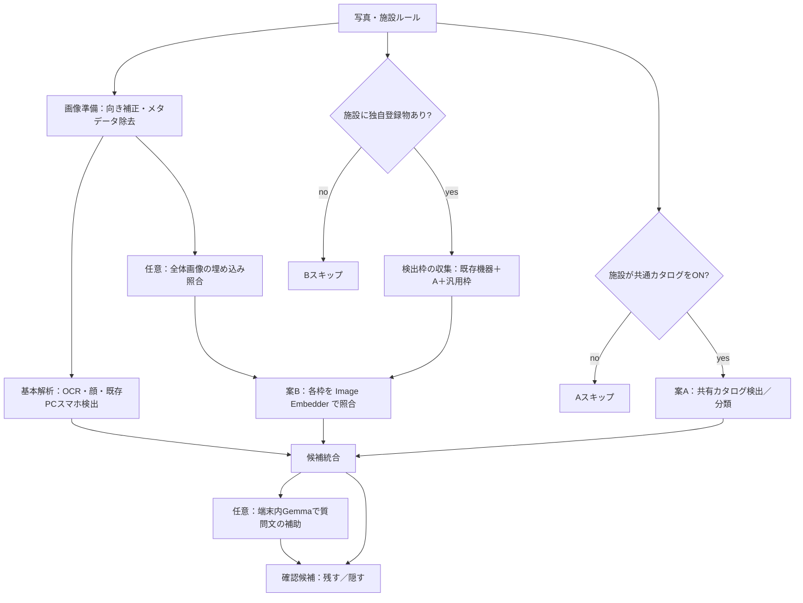

# 施設指定物の検知：案A＋案B併用 実装提案書

| 項目 | 内容 |
| --- | --- |
| 更新日 | 2026-11-09 |
| 状態 | **設計のみ。実装・精度改善・実機性能の検証は未実施。勝手に実装しないこと。** |
| 対象プロダクト | PostCheck（Flutter / iOS優先） |
| 方針決定 | 利用者指示により、**案A（共通カタログ検出）と案B（施設独自の埋め込み照合）を組み合わせ**、Googleの端末内技術で精度を最大化する |
| 対象範囲 | 撮影後チェックを本命。ライブは後続。管理Web・公開API・共通契約の拡張を含む設計 |
| 対象外 | 利用者写真のクラウドAI送信、検出結果を撮影禁止と断定すること、自動投稿、施設ごとの毎回フル再学習 |
| 関連実装（現状） | `postcheck/lib/adapters/screen_device_detector.dart`、`mlkit_perception.dart`、`check_draft.dart`、`packages/postcheck_rules/lib/contracts.dart`、`cloud/internal/rules/`、`admin_web/` |
| 関連資料 | [機器検出](screen-device-detection.md)、[管理統合V16](admin-integration-v16.md)、[要件](requirements.md)、[Google技術整理](google-tech-review.md) |

この文書は、実装担当・レビュー担当・**別のAIが同じ前提で実装着手できる**ように書く。推測と確定事実を混ぜない。本書を読んだだけでは実装完了と扱わない。

---

## 1. 一言でいうと

施設が「写してほしくない物」を指定しても、現状は **文字（OCR／登録ワード）と PC・スマホ（EfficientDet）以外の見た目検知がない**。

利用者案を次の2層に分け、Google技術を割り当てて併用する。

| 層 | 利用者の操作 | Google技術（端末内推論） | 狙い |
| --- | --- | --- | --- |
| **A. 共通カタログ** | ホワイトボード／たばこ／名札などを選択式でON | LiteRT Object Detector または ML Kit Object Detection＋カスタム分類 TFLite | 施設横断で繰り返し出る物を安定して枠付き検出 |
| **B. 施設独自** | 参考写真を撮って登録 | MediaPipe / LiteRT **Image Embedder** ＋コサイン類似度 | 一点物を再学習なしで「似ている」候補にする |

精度最大化のため、**枠取り（検出）と照合（埋め込み）を直列に組み合わせ**、端末内 Gemma は説明補助に限定する。利用者の投稿写真・OCRはクラウドAIへ送らない。

---

## 2. 現状（実装事実）と詰まっている理由

### 2.1 既存の検知役割

| 仕組み | できること | ホワイトボード／たばこ等 |
| --- | --- | --- |
| ML Kit OCR | 読めた文字の位置と文言 | 物体そのものは対象外 |
| 登録ワード（`VenuePolicy.words`） | 文字列一致 | 見た目の物体は不可 |
| EfficientDet-Lite0（既存） | `laptop` / `cell phone` / `tv` → `FindingKind.screenDevice` | **対象ラベル外**。構想のみ |
| 端末内 Gemma | 文脈上の確認質問 | 安定した物体枠の主役には不向き |

根拠コード：

- 機器検出：`ScreenDeviceDetector`（MethodChannel `postcheck/screen_detector`）、TensorFlowLiteTaskVision、しきい値0.35。[実装記録](screen-device-detection.md)
- 撮影後統合：`MlKitPerceptionAdapter.inspect` → OCR・顔・機器
- 候補化：`CheckDraft` が `FindingKind.screenDevice` を生成
- 施設配信：`VenuePolicy` に `words` はあるが、**物体カタログIDや埋め込みベクトルの項目はない**

### 2.2 管理側の既存「参考画像」との区別（重要）

V16で `sourceImage` は **審査用の根拠画像**として暗号化保存し、**公開APIから除外**している。[admin-integration-v16.md](admin-integration-v16.md)

本提案の「施設独自の参考写真」は別概念である。

| | 現行 `sourceImage` | 本提案の独自登録物（B） |
| --- | --- | --- |
| 目的 | 運営が根拠を目視確認 | 端末が写り込み候補を照合 |
| 公開API | **出さない** | **照合用データとして配信する**（原則は埋め込みベクトル。原画像を一般利用者へ出さない設計を推奨） |
| サイズ制限 | 現行はごく小さい審査用上限 | 別フィールド・別ストレージ方針が必要 |

既存 `sourceImage` を流用して検出に使わない。混同すると審査画像の公開漏れやサイズ不足が起きる。

### 2.3 プライバシー制約（変更しない）

- 解析対象の写真・文章・OCR・登録ワードはクラウドAIへ送らない（要件）。
- 共通カタログの学習は **オフライン／管理側の許諾済み・架空データ** で行い、完成した TFLite だけを配信してよい。
- 利用者投稿を Gemini API 等へ送って検出する方式は採用しない。

---

## 3. 目標と非目標

### 3.1 達成したいこと

1. 施設が共通カタログから選択した物を、撮影後チェックで枠付き確認候補にできる。
2. カタログにない施設独自物を、参考写真登録→端末内類似度で候補にできる。
3. AとBを併用し、片方だけでは拾えないケースを減らす（検出枠→埋め込み照合、必要なら全体埋め込みの補助）。
4. 既存の確認UX（候補提示、残す／隠す、利用者が最終判断）を維持する。
5. 既存の PC／スマホ検出・OCR・顔・登録ワードを壊さない。

### 3.2 達成したことにしないこと

- 「すべての禁止物を検出できる」ことの保証
- 検出＝撮影禁止・炎上回避の断定
- ライブ経路の完成（Phaseとしては後続）
- 施設ごとに毎回フル物体検出モデルを再学習する運用
- 利用者写真のクラウド推論

---

## 4. 採用アーキテクチャ（A＋B併用）



### 4.1 役割分担（精度を最大化する割り振り）

| 役割 | 担当 | 理由 |
| --- | --- | --- |
| 共通物の枠＋ラベル | **A** | 学習済み検出／分類の方が再現率が安定しやすい |
| 一点物の同一性 | **B** | 再学習なしで施設差分に追随できる |
| 枠の欠落補完 | **Bの全体照合**＋（将来）弱い汎用検出枠 | 埋め込みだけだと位置が弱い。枠がある方がマスクしやすい |
| 文脈の言い回し | Gemma（任意・後段） | 「隠しますか？」の質問補助。座標生成・確定ラベルの主役にしない |
| 最終判断 | 利用者 | 現行方針を維持 |

### 4.2 案A：共通カタログ（選択式）

#### 4.2.1 初期カタログ（狭く固定）

実装の最初の固定セット（追加は計測後）：

| catalogId | 表示名（日） | 表示名（英） | 備考 |
| --- | --- | --- | --- |
| `whiteboard` | ホワイトボード | Whiteboard | 背景に文字があることが多い。OCR候補と統合可 |
| `cigarette` | たばこ・喫煙関連 | Tobacco / smoking-related | 小物体。見逃しやすいのでタイルOCRとは別指標で測る |
| `name_badge` | 名札 | Name badge | 文字が読める場合はOCR／登録ワードと根拠を併記 |

これ以外を施設が必要とする場合は **案B** で登録する。カタログを無制限に増やさない。

#### 4.2.2 技術選定（Google）

推奨順位：

1. **本命（枠が正確）**  
   既存の EfficientDet／Task Vision 路線を拡張し、**カタログ用のカスタム物体検出 TFLite** を LiteRT Object Detector で実行する。  
   学習：Vertex AI AutoML Image Object Detection の Edge 向け（例：`MOBILE_TF_HIGH_ACCURACY_1` または `MOBILE_TF_VERSATILE_1`）→ TFLite エクスポート。  
   注意：AutoML の **物体検出モデルは ML Kit 非対応**（公式注記）。ML Kit に直接載せない。

2. **代替（分類特化）**  
   **ML Kit Object Detection & Tracking ＋ カスタム画像分類 TFLite**。  
   枠は ML Kit、ラベルは自前分類器。AutoML Vision Edge の **画像分類** モデルは ML Kit カスタムAPIで利用可能。  
   検出上限（例：最大5物体）や枠の粗さがあるため、小物体（たばこ）では本命より弱い可能性がある。Phase 0で比較する。

3. **既存機器検出との関係**  
   `laptop` / `cell phone` / `tv` は現状モデルを維持。カタログモデルとラベル空間を混ぜて壊さない。別モデル・別アダプタとして呼び、結果をマージする。

#### 4.2.3 配信

- モデル本体は Git に含めない（現行 `setup_screen_detector.sh` と同様）。
- SHA-256 と版番号をマニフェストで管理。
- 施設ルールには **catalogId の選択リストだけ** を載せ、巨大モデルを施設ごとに複製しない。
- アプリは共有モデルを1つ（または版付き）持ち、施設ONのIDだけを有効ラベルとして採用する。

### 4.3 案B：施設独自（写真登録→埋め込み）

#### 4.3.1 技術（Google）

- **MediaPipe / LiteRT Image Embedder**  
  参考： [Image Embedder](https://developers.google.com/edge/mediapipe/solutions/vision/image_embedder)  
  推奨モデル例：MobileNetV3 embedder（公式サンプル）。最終モデルは Phase 0 で固定する。
- 類似度：公式の `cosineSimilarity`（おおよそ -1〜1、高いほど類似）。
- SDK注意：過去に MediaPipeTasksVision と既存 Google SDK の競合・初期化停止があった。[screen-device-detection.md](screen-device-detection.md)  
  **Image Embedder 導入は別ブランチでリンク検証を必須とする。** 競合する場合は LiteRT Task Library の Image Embedder 経路を優先検討する。

#### 4.3.2 データ流れ

```text
管理Web（申請者）
  独自物ごとに表示名＋参考写真 3〜8枚（角度・距離を変える）
  → サーバーまたは管理側ジョブで埋め込みベクトルを計算（推奨）
  → 公開版に vectors + メタデータのみ載せる
  → 原画像は一般公開APIに出さない（運営・申請者のみ保持可）

iPhone（撮影後）
  検出枠（既存機器＋A＋必要なら汎用枠）をクロップ
  → 端末内 Embedder でベクトル化
  → 施設の登録ベクトルとコサイン類似度
  → しきい値以上を確認候補にする
  → 枠が無い場合のみ全体画像照合（位置は写真全体／手動指定へ誘導）
```

埋め込み計算を端末だけで行う設計も可能だが、公開バンドルサイズと端末負荷を抑えるため **配信はベクトル優先** とする。計算場所（サーバー／管理CLI／端末）は Phase 1 で1つに固定する。サーバー計算でも **利用者の投稿写真は送らない**。送るのは施設が明示登録した参考写真のみ。

#### 4.3.3 しきい値と誤検出

- しきい値はカタログ／独自物で別管理。初期値は開発セットで決め、都合のよい画像ごとに変えない。
- 「似ている」は誤検出がある前提。UI文言は断定しない（例：「登録した物に似ています。隠しますか？」）。
- 同一写真でAとBが同じ領域を指す場合は **1つの確認項目に統合**し、根拠に `catalog` / `embedding` の両方を残す。

### 4.4 A＋Bの具体的な併用規則（精度最大化）

1. **施設がカタログONのラベル**は、まずAの検出結果を採用する（枠＋ラベル）。
2. **施設独自物**は、Aおよび既存機器検出の枠をクロップしてB照合する（枠あり照合を優先）。
3. Aがカタログ物を検出したが信頼度が低い場合、同じ枠をBの「白板／たばこ等の代表埋め込み」（任意の共有 prototypes）と突合して補強してよい。prototypes が無い場合はAのみ。
4. 枠が0件でも独自登録がある場合、全体埋め込みを1回だけ行い、類似なら `WholePhotoTarget` または手動範囲指定へ誘導する。写真全体を自動で塗りつぶさない。
5. OCRで読めた「禁煙」「ホワイトボード」等の文字列は **登録ワード／OCR候補として別根拠**にできるが、物体検出の代替にしない。
6. Gemmaは検出後の質問文生成に限定。新しい物体座標を生成させない（現行 `ai_contract` の座標禁止を維持）。

### 4.5 確認候補への載せ方

| 項目 | 方針 |
| --- | --- |
| FindingKind | 新規 `facilityObject`（表示は日英：「施設の指定物」／ "Venue-listed object"）を追加。既存 `screenDevice` と混ぜない |
| FindingSource | `deviceModel`（A）／新規 `embedding`（B）／両方を ReviewItem 内根拠に保持 |
| 質問例 | 「ホワイトボードが写っているようです。隠しますか？」「施設が登録した展示物に似ています。隠しますか？」 |
| マスク | 枠がある場合はその領域。無い場合は手動範囲指定へ |
| 重複 | 同一領域のA/Bは1カードに統合 |

---

## 5. データ契約（実装者が迷わないための草案）

### 5.1 施設ポリシー拡張（公開API向け）

`VenuePolicy` に相当する公開フィールド案（正式な JSON キーは実装時に互換テストで固定）：

```json
{
  "objectCatalogIds": ["whiteboard", "cigarette"],
  "customObjects": [
    {
      "id": "ex-001",
      "label": "試作品A",
      "labelEn": "Prototype A",
      "embeddingModelId": "mobilenet_v3_small_embedder@1",
      "similarityThreshold": 0.78,
      "vectors": [
        { "dims": 1024, "values": ["…quantized or float…"] }
      ]
    }
  ]
}
```

制約案：

- `objectCatalogIds`：初期は上記3種のみ。未知IDは無視し、アプリを落とさない。
- `customObjects`：施設あたり件数上限（初期案 10）、ベクトル数上限（初期案 各8）、ベクトル次元はモデルIDと一致必須。
- `contact` / `sourceImage` / 審査用データは現行どおり公開から除外。
- `rulesDigest` にカタログIDと独自物ID・しきい値・ベクトルハッシュを含め、変更時に翻訳再確認などの既存仕組みと整合させる。

### 5.2 管理Web UI

申請者画面に次を追加する（見た目は既存管理Webに合わせる）：

1. **よくある物**：チェック選択（カタログ）。
2. **この施設だけの物**：名前＋写真追加（複数枚）。プレビューと削除。
3. 保存・申請時バリデーション（枚数・形式・上限）。
4. 運営は公開前にカタログ選択と独自物の妥当性を目視確認できること。

現行の禁止ワード入力は残す。物体指定の代替ではない。

### 5.3 アプリ側ポート

| 層 | 変更 |
| --- | --- |
| domain | `FacilityObjectObservation`（label/catalogId/customObjectId、正規化矩形、score、source） |
| application | 施設ルールのON物だけを対象にA/B実行、結果マージ、Finding生成、時間予算 |
| adapters | カタログ検出アダプタ、Embedderアダプタ、モデル読込・解放 |
| presentation | 確認リスト文言、手動範囲、未完了表示。技術設定を一般利用者に増やさない |

`PerceptionPort.inspect` の単一 Future に押し込みすぎない。機器検出と同様、失敗してもOCR等は継続する。

---

## 6. 処理時間・失敗・キャンセル

初期予算案（実測後に確定。数値は仮説）：

| 段階 | 予算案 |
| --- | --- |
| 既存 perception（OCR・顔・機器） | 現行どおり全体上限の中で優先 |
| 案Aカタログ検出 | 追加最大 2〜3秒（撮影後） |
| 案B埋め込み（枠ごと） | 枠数上限（例：8）×単推論。追加最大 3秒 |
| 全体埋め込みフォールバック | 1回のみ |
| Gemma | 現行どおり別枠。物体検出の必須条件にしない |

規則：

- 施設ルールでA/B対象が無ければ呼び出さない。
- 時間切れ時は取得済み基本結果を返し、「施設指定物の見た目チェックは未完了」を日英で示す。
- ネイティブ失敗は機器検出と同様に注記し、チェック全体を失敗扱いにしない。
- MediaPipe／TaskVision の同時初期化競合を避ける。重いエンジンは逐次実行を既定とする。

---

## 7. スコープとフェーズ

### Phase 0：計測とSDK検証（実装の前提）

1. 架空データでホワイトボード／たばこ／名札／一点物／対象なしの写真セットを用意（実在個人情報なし）。
2. ベースライン：現行（OCR＋機器のみ）。
3. Image Embedder の iOS リンク検証（競合の有無を記録）。
4. 案Aの2経路（カスタム検出 vs ML Kit＋分類）を小規模比較し、本命を1つに決める。
5. 類似度しきい値・誤検出上限・時間上限を数値で記録してから本番実装に入る。

### Phase 1：撮影後＋契約＋管理（推奨の最初の実装スコープ）

実装する：

1. 公開契約：`objectCatalogIds` / `customObjects`（ベクトル配信）。
2. 管理Web：カタログ選択＋独自写真登録。
3. アプリ：撮影後のみ A＋B 併用パイプライン。
4. 確認UI：`facilityObject` 候補、手動範囲。
5. 自動テスト：JSON互換、未知ID無視、マージ、しきい値、公開APIから審査画像除外の退行防止。

実装しない（このPhase）：

- ライブカメラでの施設指定物検出
- カタログの無制限追加
- Gemmaによる物体座標生成
- 利用者写真のクラウド検出

### Phase 2：精度チューニング

- しきい値・枠上限・タイル切出しの有無
- 共有 prototypes によるAの低信頼補強
- 必要ならカタログモデル再学習（オフライン）

### Phase 3：ライブ（任意）

- 既存750ms間隔・同時1本の制約内で、カタログ検出のみ間引き実行などを検討。
- Bの埋め込みは負荷が高いため、ライブは枠表示に留め、詳細照合は撮影後でもよい。

---

## 8. 受入条件（Phase 1）

すべて満たしたら Phase 1 完了とする。未計測の数値目標は「完了」と書かない。

1. 利用者の投稿写真・OCRがクラウドAIへ送られない。
2. 審査用 `sourceImage` が公開APIに出ていない（退行なし）。
3. 施設がカタログOFFかつ独自物0なら、A/Bのネイティブ呼び出しが走らない。
4. カタログON時、架空セットで対象物の見逃しがベースラインより改善（分母を記録）。
5. 独自登録物で、登録写真と近い条件の撮影が候補になること。大きく違う無関係画像での誤検出が事前上限内。
6. AとBが同一領域を二重カードにしない。
7. 検出失敗・時間切れでも OCR／顔／機器／登録ワードの結果を保持する。
8. 断定文言（禁止・安全保証）をUIに追加していない。
9. 単体／契約テストと、架空データでの実機記録がある。ローカル成功だけを実機成功と書かない。
10. モデル重量・秘密情報をGitに含めていない。

---

## 9. 実装時のファイル指針（着手マップ）

実装AIは次を起点にする。本書以外の要件と衝突する場合は実装前に止めて確認する。

| 領域 | 主な場所 |
| --- | --- |
| 契約 | `packages/postcheck_rules/lib/contracts.dart` および Go の同等構造体 |
| 公開除外 | `cloud/internal/rules` の公開変換（`sourceImage` / `contact` と同列の取り扱いを独自物原画像にも適用） |
| 管理UI | `admin_web/lib/venue_editor.dart` ほか申請フォーム |
| 検出ネイティブ | `postcheck/ios/` の TaskVision 周辺、`screen_device_detector` の拡張または並列アダプタ |
| Dartアダプタ | `postcheck/lib/adapters/` に catalog／embedder を分離 |
| 統合 | `mlkit_perception.dart` / `check_draft.dart` |
| UI | `finding_review_list.dart`、日英 l10n |
| モデル取得 | `postcheck/scripts/` にセットアップとSHA検証（Git対象外） |
| テスト | `packages/postcheck_rules/test/`、`cloud/internal/rules/`、`postcheck/test/` |

---

## 10. リスク

| リスク | 影響 | 対策 |
| --- | --- | --- |
| MediaPipe SDK競合 | ビルド不可・初期化停止 | Phase 0でリンク検証。LiteRT経路へ退避 |
| 埋め込み誤検出 | 不要な確認が増える | しきい値、枠あり優先、上限件数、文言を非断定 |
| 小物体（たばこ）見逃し | A単独では弱い | 高解像度クロップ、複数枚学習、Bとの併用 |
| 公開API肥大 | 配信・メモリ悪化 | ベクトル量子化、件数上限、原画像非配信 |
| 審査画像との混同 | 根拠画像の漏洩 | フィールド分離、テストで公開除外を固定 |
| 処理時間増 | タイムアウト | 施設OFF時スキップ、枠数上限、逐次実行 |
| 効果の過大説明 | 発表・利用者誤解 | 「確認候補の改善」であり検出保証ではないと明記 |

---

## 11. やらないこと（明示）

1. 施設ごとに毎回フル物体検出モデルを学習し直す運用を標準にすること
2. 利用者写真をクラウドの Gemini / Vision API に送って検出すること
3. OCR登録ワードだけで物体検知完了とみなすこと
4. 検出結果を撮影禁止・安全の断定にすること
5. 既存 PC／スマホ検出をカタログ学習で上書きして壊すこと
6. 本書の作成時点でアプリ実装・TestFlight更新を行うこと（**禁止。設計のみ**）

---

## 12. 作業時の読み方（人／AI向け）

1. まず Phase 0（計測とSDK検証）なしに本番実装へ入らない。
2. AとBは両方実装する。どちらか一方だけを「完了」と呼ばない。
3. 公開する独自物データはベクトル優先。審査用 `sourceImage` と混ぜない。
4. Google技術の中心は **LiteRT／ML Kit（端末推論）＋（任意）Vertex AutoML Edge（学習のみ）＋ Image Embedder**。Gemmaは補助。
5. 完了報告では見逃し・誤検出・処理時間をベースライン比較で書く。
6. 実在の施設写真や個人が写る学習データをリポジトリやログに残さない。

---

## 13. 意思決定

### 決定済み（2026-11-09 利用者指示）

- 案Aと案Bを組み合わせ、Google技術で精度を最大化する方向で進める。
- 本提案書を `iwase` 上で作成し、`main` へ共有する。
- **この指示の範囲では実装コードを変更しない。**

### 未決（実装前の Phase 0 で決める）

1. 案Aの本命経路（カスタム物体検出 vs ML Kit＋分類）の実測選定結果
2. Embedder モデルID・次元・量子化の有無
3. 類似度しきい値と誤検出の許容上限
4. 埋め込み計算をサーバー／管理CLI／端末のどこで行うか
5. Phase 1 の体感待ち時間・p95目標
6. ライブを Phase 3 でやるか、大会までに切るか

---

## 14. 参考リンク

- [ML Kit：カスタムモデル付き物体検出（iOS）](https://developers.google.com/ml-kit/vision/object-detection/custom-models/ios)
- [ML Kit：カスタムモデル全般（AutoML検出モデルはML Kit非対応の注記あり）](https://developers.google.com/ml-kit/custom-models)
- [LiteRT Object Detector](https://developers.google.com/edge/litert/libraries/task_library/object_detector)
- [MediaPipe Image Embedder](https://developers.google.com/edge/mediapipe/solutions/vision/image_embedder)
- [Vertex AI AutoML 画像物体検出の Edge エクスポート例](https://github.com/GoogleCloudPlatform/vertex-ai-samples/blob/main/notebooks/official/automl/automl_image_object_detection_export_edge.ipynb)
- 既存機器検出： [screen-device-detection.md](screen-device-detection.md)
