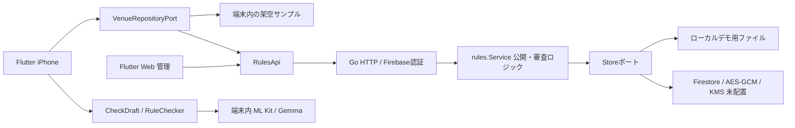

# V5実装記録 — 施設ルールとWeb管理

> 本書はV5時点の記録。現在の自動候補・ON/OFFと匿名利用の範囲は[実装記録V6](implementation-v6.md)を優先。

2026-11-08。UI V5の設計を既存Flutterアプリと別のFlutter Web管理画面へ反映。Google Mapsキーとクラウド配置はユーザー指定で後回し。写真・投稿文・OCRの解析は引き続き端末内です。

## 実装した流れ

**スマホ**：ホーム → 場所を選ぶ（地図／一覧／QR）→ 撮影・SNS公開・商用利用の条件と根拠・版を確認 → 適用 → 撮影／写真選択 → OCRと施設ワードを端末内で照合 → 根拠付きの候補を確認・修正 → 再チェック → 保存・OS共有。

- キー未設定時は地図を表示せず、施設一覧を使えます。API未設定の通常ビルドは架空の施設2件を明示したデモ。接続先を設定した場合、取得失敗をデモデータへ置き換えません。
- 写真ライブラリから選ぶ場合は、選択した施設・エリアと撮影場所が一致するか利用者に確認します。撮影禁止ならカメラへ入る前にルールを案内し、条件付き・未確認なら確認ダイアログを表示します。
- カメラは既存の全画面プレビューと内カメラ回転修正を維持。ライブ文字検出にも適用ルールを渡します。
- QRは `postcheck://venue/{id}` のみ。外部URLを自動で開いたり、QRだけで管理権限を作ったりしません。
- ルールの有効期限と名称解禁日時を分離。期限切れのワードは適用せず、未確認として案内します。日時はUTC保存、日本時間で編集・表示。
- 施設変更でチェック結果を無効化。個人辞書へ施設ワードを混ぜません。組織限定の選択は設定画面から戻る際に解除し、アカウント変更後の再取得を必要とします。

**組織Web**：Googleログイン → 施設一覧 → 位置・名前・住所・担当者 → 条件・ワード・解禁日時・根拠 → 一般公開／組織限定を確認 → 下書き保存／申請。

**運営Web**：一覧 → 現在公開中のルールと申請内容を比較 → 所属・根拠を確認 → 承認／理由付き差し戻し。公開後は理由付き公開停止。申請者は取り下げ可能。

公開するワードも端末へ配信されることをプレビューで警告し、一般公開は確認チェック必須。連絡先・所属・差し戻し理由を公開APIへ含めません。内部メモ専用UIは未追加です。

## 技術構成と分離

共有Dartパッケージ `packages/postcheck_rules` の `contracts.dart` はUI・HTTP・Google SDK非依存。既存アプリのapplicationはこの契約だけを参照。HTTP実装・デモは別ファイル。Goのルール層もHTTP・Google SDKから分離しています。

サーバーは申請版を固定し、バージョンとストレージrevisionで競合を拒否。承認まで旧公開版を維持します。公開停止・有効期限・組織限定を配信時に確認。承認・差し戻し・公開停止の担当者・版・時刻を最大500件記録します。

本番用Firestoreアダプターは、復元APIと同じKMSラップ鍵＋AES-256-GCM方式でルールレジストリを暗号化します。運営が復号できる方式で、E2E暗号化ではありません。小規模試作として最大100施設、暗号化前700KBの単一レコード。大規模運用には施設単位の保存・配信キャッシュ・監査保管・流量制限が必要です。

## 接続と起動

- 管理画面：[admin_web/README.md](../admin_web/README.md)
- Go API：[cloud/README.md](../cloud/README.md)
- モバイル設定例：`postcheck/config/rules.example.json` を `rules.local.json` へコピー。
- `RULE_API_URL`：HTTPSのAPIベースURL。未指定なら明示した架空デモ。
- `MAPS_ENABLED`：初期false。iOSでは `GOOGLE_MAPS_API_KEY` をMaps SDK for iOS・実際のBundle IDで制限して設定。
- Androidでは別のMaps SDK for Android用キーを `POSTCHECK_MAPS_API_KEY` Gradleプロパティで設定し、アプリIDと署名証明書で制限。Android実機は未検証。
- iOS：`flutter build ios --release --dart-define-from-file=config/rules.local.json`。認証も使う場合はcloud設定と同じローカルJSONへ統合。秘密鍵は含めません。
- WebのMapsキーは別設定。ブラウザリファラー制限を使います。

## 検証と残る確認

- Go `go test -race ./...` / `go vet ./...`：通過。認可、公開版維持、同版競合、期限、未知JSON拒否を検証。
- 共有Dart：3件通過。解禁・期限境界、QR形式、未確認の扱い。
- モバイル：`flutter analyze` 問題なし、25件の単体・Widgetテスト通過。320px幅＋文字拡大で従来の文章チェック→修正→共有導線、320px幅で施設一覧→適用も確認。
- Dartクライアント→実GoデモAPI：登録→申請→承認→一般公開取得→停止まで通過。公開応答に連絡先がないことを確認。
- 管理Web：`flutter analyze` 問題なし、2件のWidgetテスト通過。保存失敗・未保存離脱・公開確認・申請後復帰を検証。
- iOSリリースビルド（デバイス向け）とFlutter Webリリースビルド：通過。VALIARK開発用署名で `jp.kawakou.postcheck` を接続iPhoneへインストール・起動済み。TestFlightへの追加アップロードは行っていません。
- 新しい施設画面・QR・Maps/GPSの実機操作は別途確認が必要。過去のカメラ確認をV5の検証として流用しません。

ルールは取得した時点の版をそのセッションで適用します。サーバーでの停止・変更を端末へ即時プッシュする機能や永続オフラインキャッシュは未実装。現場掲示・原文確認を併用します。Places自由検索、PDF自動抽出、場所の自動断定、動画、自動投稿はこの版に含めません。

実サービスのGoogleログイン、Maps表示、Firestore/KMS、Cloud Run／Hosting配置は未実施。指定Google Cloud実行基盤を使う大会条件は、コードの完成だけでは達成扱いにしません。
